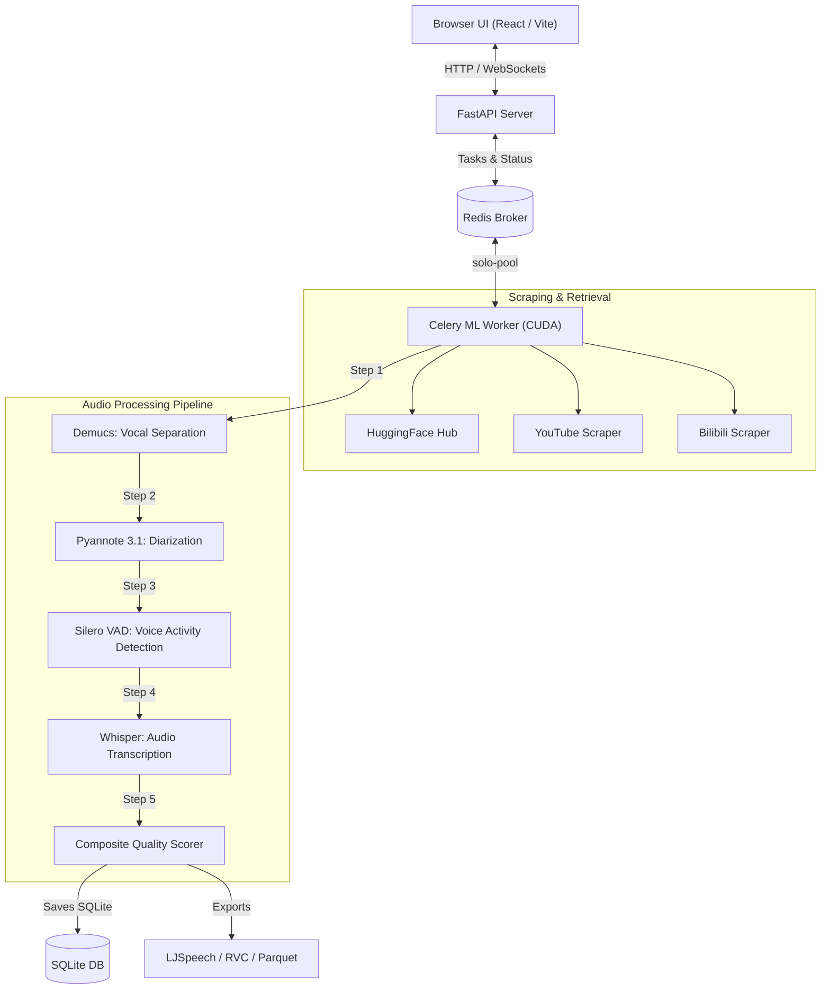

<p align="center">
  
</p>

# 🎙️ Beatrice Dataset WebUI (VoiceForge Dataset Studio) - Windows Edition

[](https://opensource.org/licenses/MIT)
[](https://microsoft.com/windows)
[](https://developer.nvidia.com/cuda-zone)
[](https://www.python.org/)
[](https://nodejs.org/)
[](https://fastapi.tiangolo.com/)
[](https://react.dev/)

An elegant, all-in-one AI voice dataset creator custom-tailored for **Windows**. Search any character, celebrity, or voice actor to automatically download, clean, segment, transcribe, and score high-quality voice datasets. Output formats are ready-to-train for **Beatrice V2**, **RVC**, **XTTS**, **StyleTTS2**, and **Tortoise**.

---

## ✨ Features

- **🔍 Universal Search** — Instantly scan anime characters, celebrities, voice actors, game characters, and musicians.
- **🌐 Multi-Source Extraction** — Auto-scrape audio from HuggingFace Hub, YouTube, Bilibili, Nicovideo, OpenSLR, and Archive.org.
- **🧠 Advanced ML Pipeline**:
  - **Vocal Separation**: [Demucs (htdemucs_ft)](https://github.com/facebookresearch/demucs) isolates the voice from background music/noise.
  - **Speaker Diarization**: [Pyannote 3.1](https://huggingface.co/pyannote/speaker-diarization-3.1) separates and groups distinct speakers.
  - **Voice Activity Detection**: [Silero VAD](https://github.com/snakers4/silero-vad) trims silences and splits audio into natural speech chunks.
  - **Transcription**: [Whisper](https://github.com/openai/whisper) automatically transcribes audio in Japanese, English, Chinese, and more.
- **📊 Quality Scoring** — Composite 0–100 quality scoring based on Signal-to-Noise Ratio (SNR), spectral cleanliness, duration, clipping, and silence ratios.
- **💾 Export Formats** — One-click export to standard formats:
  - **LJSpeech** (WAVs + `metadata.csv` for Beatrice, StyleTTS2, XTTS)
  - **RVC** (WAVs grouped by speaker + `filelist.txt` for RVC/Diff-SVC)
  - **Custom JSON** (Raw files + full metadata detailing clip scores, sources, and word-level timestamps)
- **⚡ Universal Converter** — Instantly convert any batch of audio files (WAV, MP3, FLAC, OGG, OPUS, M4A) with customizable sample rate, channel layout, and bit depth.
- **📈 Real-Time Web Console** — Monitor downloads, ML stages, audio waveforms, transcriptions, and quality graphs live over WebSockets.

---

## 🪟 Windows Native & CUDA Tuning

This studio is specifically optimized for Windows execution:
1. **NVIDIA CUDA GPU Acceleration** — Automatically detects NVIDIA GPUs (`nvidia-smi`) and configures PyTorch with CUDA 12.1 / 11.8 for fast model execution (Demucs, Pyannote, Silero VAD, Whisper).
2. **Win32 Celery Solo Execution Pool** — Configured with `-P solo` pool mode on Windows to bypass Windows process fork limitations and prevent multi-process memory conflicts with PyTorch/CUDA.
3. **One-Click Batch & PowerShell Launchers** — Includes native `setup.bat` / `start.bat` and PowerShell `setup.ps1` / `start.ps1` for easy one-click installation and execution.

---

## 📸 Screenshots

### 🔍 Search & Discovery Dashboard
<p align="center">
  
</p>

### 🔄 Universal Audio Converter
<p align="center">
  
</p>

---

## 🗺️ System Architecture



---

## 🚀 Quick Start (Windows)

### Prerequisites

1. **Python 3.11 or 3.12** ([Download Python](https://www.python.org/downloads/)) — Ensure "Add Python to PATH" is checked during installation.
2. **Node.js 18+** ([Download Node.js](https://nodejs.org/))
3. **FFmpeg** (Required for audio processing):
   ```cmd
   winget install Gyan.FFmpeg
   ```
4. **Redis Server** or **Memurai**:
   ```cmd
   winget install Redis-Windows.Redis-Windows
   ```

---

### 1. Installation

#### Option A: Command Prompt (Batch)
Double-click `setup.bat` or run:
```cmd
setup.bat
```

#### Option B: PowerShell
Right-click `setup.ps1` and select *Run with PowerShell*, or run:
```powershell
.\setup.ps1
```

#### Option C: Git Bash
```bash
chmod +x setup.sh start.sh
./setup.sh
```

---

### 2. Configure Pyannote (Required for Diarization)

Pyannote Speaker Diarization requires accepting user agreements and generating a HuggingFace Token:
1. Visit [pyannote/speaker-diarization-3.1](https://huggingface.co/pyannote/speaker-diarization-3.1) and accept the terms.
2. Visit [pyannote/segmentation-3.0](https://huggingface.co/pyannote/segmentation-3.0) and accept the terms.
3. Create a HuggingFace User Access Token at [hf.co/settings/tokens](https://huggingface.co/settings/tokens).
4. Paste the token into `voiceforge-backend/.env`:
   ```ini
   HF_TOKEN=your_token_here
   ```

---

### 3. Run the Studio

#### Option A: Command Prompt (Batch)
Double-click `start.bat` or run:
```cmd
start.bat
```

#### Option B: PowerShell
```powershell
.\start.ps1
```

#### Option C: Git Bash
```bash
./start.sh
```

- **Frontend Console:** [http://localhost:5173](http://localhost:5173)
- **FastAPI Backend:** [http://localhost:8001](http://localhost:8001)
- **Interactive OpenAPI Documentation:** [http://localhost:8001/docs](http://localhost:8001/docs)

---

## 🛠️ API & CLI Usage

### 1. Create a Dataset Search & Process Job
Start pulling and processing a target character's voice:
```bash
curl -X POST http://localhost:8001/api/jobs/create \
  -H "Content-Type: application/json" \
  -d '{
    "query": "Gojo Satoru",
    "query_type": "anime",
    "language": "jp",
    "options": {
      "target_duration_minutes": 30,
      "quality_threshold": 65,
      "output_format": "ljspeech"
    }
  }'
```

### 2. Search Preview
See matching sources and duration estimates before processing:
```bash
curl -X POST http://localhost:8001/api/search/preview \
  -H "Content-Type: application/json" \
  -d '{"query": "Kobe Bryant", "query_type": "celebrity", "language": "en"}'
```

### 3. Universal File Batch Converter
Normalize a folder of miscellaneous audio format files to studio format:
```bash
curl -X POST http://localhost:8001/api/convert \
  -F "files=@vocals.mp3" \
  -F "sample_rate=22050" \
  -F "channels=mono"
```

---

## 📦 Output Layouts

Outputs are structured under `voiceforge-backend/static/outputs/`:

### LJSpeech (Beatrice V2 / XTTS / StyleTTS2)
```
dataset_ljspeech/
├── metadata.csv       # Filename | Raw Transcript | Normalized Transcript
└── wavs/
    ├── 0001.wav       # 22.05kHz, Mono, 16-bit PCM WAV
    ├── 0002.wav
    └── ...
```

### RVC / Diff-SVC
```
dataset_rvc/
├── filelist.txt       # relative/path/to/audio.wav | speaker_id
└── speaker_0/
    ├── 0001.wav
    ├── 0002.wav
    └── ...
```

---

## ⚙️ Configuration (.env)

Adjust parameters in `voiceforge-backend/.env` for customized runs:

| Variable | Default | Description |
|----------|---------|-------------|
| `HF_TOKEN` | *None* | HuggingFace Token (required for Pyannote model initialization) |
| `WHISPER_MODEL` | `large-v3` | Size of whisper model to use (`tiny`, `base`, `small`, `medium`, `large-v3`) |
| `USE_GPU` | `auto` | Auto-detect GPU (`auto`, `cuda`, `cpu`, `mps`) |
| `DEFAULT_QUALITY_THRESHOLD` | `60` | Minimum composite score (0-100) to keep clip |
| `DEFAULT_MIN_CLIP_S` | `1.5` | Min clip length in seconds |
| `DEFAULT_MAX_CLIP_S` | `25.0` | Max clip length in seconds |
| `DEFAULT_MIN_SNR_DB` | `15.0` | Minimum Signal-to-Noise ratio for quality filter |

---

## 📁 Directory Structure

```
.
├── frontend/               # React + Vite + Tailwind CSS WebUI
├── voiceforge-backend/     # FastAPI + Celery + ML Pipelines
│   ├── api/                # Route definitions & websocket handlers
│   ├── processing/         # Demucs, Pyannote, Silero & Whisper integrations
│   ├── sources/            # Scrapers for HF, YouTube, Bilibili, etc.
│   └── workers/            # Celery task definitions
├── setup.bat               # Windows Batch setup script
├── start.bat               # Windows Batch unified startup runner
├── setup.ps1               # Windows PowerShell setup script
├── start.ps1               # Windows PowerShell startup runner
├── setup.sh                # Bash setup installer (Git Bash / Linux / macOS)
├── start.sh                # Bash unified startup runner
├── LICENSE                 # License terms (MIT)
└── README.md               # You are here
```

---

## 🧪 Testing

Verify backend services and pipeline functions:
```cmd
cd voiceforge-backend
venv\Scripts\activate
pytest tests/ -v
```

---

## 📝 License & Disclaimers

This project is licensed under the **MIT License**. 

*Audio downloaded using scrapers is sourced from publicly available domains. Users must ensure compliance with licensing terms of individual websites and copyright guidelines before utilizing datasets for commercial models.*
